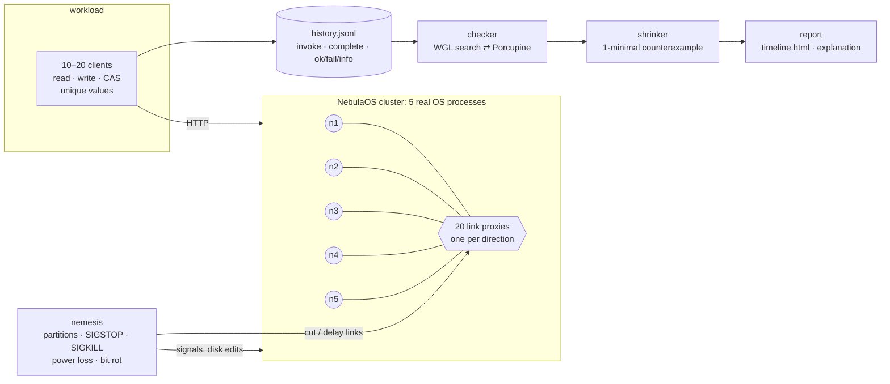
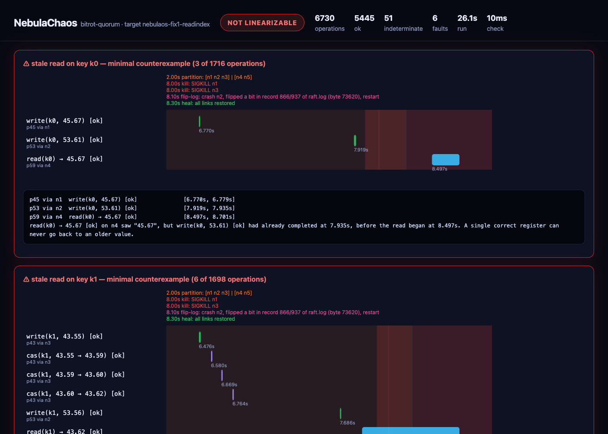

<div align="center">


# NebulaChaos

### My Raft cluster survived every crash test. Then I made it lie.

**A Jepsen-style correctness lab for [NebulaOS](https://github.com/coolstack-coder/NebulaOS): real processes, real faults, every operation recorded, every history checked for linearizability.**


</div>

---

## 🎬 Demo

<p align="center">
  <a href="docs/media/nebulachaos-demo.mp4"></a>
  <br/><sub>▲ A replay of a real run against upstream NebulaOS. <b><a href="docs/media/nebulachaos-demo.mp4">Full walkthrough with subtitles (MP4)</a></b> · <a href="docs/media/nebulachaos-demo.srt">subtitles (.srt)</a></sub>
</p>

## TL;DR

[Part 1](https://www.linkedin.com/feed/update/urn:li:activity:7519989880941264898/) showed that [NebulaOS](https://github.com/coolstack-coder/NebulaOS) — a small Kubernetes with Raft written from scratch — **survives** crashes: kill the leader and the cluster heals in 3.2 s. Surviving is a much lower bar than **staying correct**. A cluster can elect a new leader in half a second and still serve a stale read, lose a write it acknowledged, or apply a command twice. A recovery timer never notices any of that.

NebulaChaos runs five real NebulaOS processes and points concurrent clients at them. It injects network partitions, `SIGSTOP` pauses, crashes, power cuts and bit rot, and records every operation. It then asks one question: **could a single, correct machine have produced this history?**

It found **three real bugs**. Each one was reproduced, explained down to a 2–4 operation counterexample, fixed in NebulaOS, and shown to be gone on the same fault schedules:

| # | bug | how it showed up | before the fix | after |
|---|---|---|---|---|
| 1 | **Stale reads** — followers (and a deposed leader) answered from their local copy | a read returns a value that was overwritten *before the read began*, even with **no faults at all** | **10 / 10** runs non-linearizable | **0 / 10** |
| 2 | **One bit of rot erased acknowledged writes** — log recovery treated a bad checksum as a torn tail and silently truncated | after a crash, the damaged node helped elect a leader that never had dozens of acknowledged writes | **9 / 10** runs lost acknowledged writes | **0 / 10** (the node now refuses to start) |
| 3 | **Commands applied twice** — internal retries after a leader change were not idempotent | a client was told `cas mismatch` for a compare-and-set that had **succeeded**, or a value written once came back | **4 / 15** runs under leader churn | **0 / 15** |

And the checker is held to the same standard. Two independent implementations must agree on **20,000** random histories. **3 of 4** deliberately planted Raft bugs are caught, while control runs of the same schedules pass. After the fixes, **60 randomized fault schedules (284,732 operations, 281 faults)** came back linearizable.

> **The protocol was fine. All three bugs lived in the plumbing around it**: the read path, the retry loop and crash recovery. That is the same point Ram made under the first post: durability plumbing, not consensus, sets the real ceiling.

## Why this project exists

Most "chaos testing" stops at *did it come back up?* That is availability. The harder question is **safety**: did the system ever tell a client something that wasn't true?

[Jepsen](https://jepsen.io) made that question routine for databases. It found [stale reads in etcd and Consul](https://aphyr.com/posts/316-call-me-maybe-etcd-and-consul), [21 issues in Redis-Raft](https://jepsen.io/analyses/redis-raft-1b3fbf6) and lost writes in MongoDB. NebulaChaos applies the same method to my own Raft implementation, and adds what a solo project needs to be trusted: a checker validated against a reference, a set of planted bugs it must catch, and replayable fault schedules.

## 🐞 What it found

### Bug 1 — stale reads, even with zero faults

The very first run against upstream NebulaOS failed in the first 200 ms, before any fault had been injected. Here is the same thing from the run in the video (`--target nebulaos-baseline --schedule schedules/isolate-leader.yaml --seed 7`), shrunk from 2,248 operations on that key to 3:

```text
p5 via n1  write(k1, 5.3) [ok]                [0.082s, 0.110s]
p7 via n3  write(k1, 7.5) [ok]                [0.121s, 0.144s]
p6 via n2  read(k1) → 5.3 [ok]                [0.157s, 0.157s]

read(k1) → 5.3 on n2 saw "5.3", but write(k1, 7.5) had already completed at 0.144s,
before the read began at 0.157s. A single correct register can never go back to an older value.
```

**Why:** every `GET` was served from the local replica. A follower applies an entry only when the *next* heartbeat tells it the entry committed, so it trails the leader by up to one heartbeat. A partition makes it worse. The cut-off leader keeps answering for up to about 0.9 s, until check-quorum makes it step down, while the majority has already elected a new leader and is taking writes.

**Fix** ([`nebulaos-fix1-readindex`](../../commit/nebulaos-fix1-readindex)): this is the read-only query protocol from the Raft thesis (§6.4).
- **ReadIndex on the leader:**
  1. wait for an entry of the current term to commit;
  2. record the commit index;
  3. prove leadership with a majority answering heartbeats that were **sent after** the read arrived;
  4. serve once the state machine has applied that index.
- **A no-op read barrier for followers:** the follower serves the read once it has applied the barrier itself.
- **A subtle part:** `lastApplied` runs ahead of the state machine while a batch is being applied, so the fix tracks the index the FSM has *actually* applied.

| `isolate-leader`, 10 seeds | runs | operations | non-linearizable |
|---|---|---|---|
| upstream read path | 10 | 93,654 | **10** |
| ReadIndex + read barrier | 10 | 42,852 | **0** |

The honest cost: linearizable reads from followers need a round trip through the leader, so throughput in this test roughly halves.

### Bug 2 — one flipped bit erased acknowledged writes

The schedule [`bitrot-quorum`](schedules/bitrot-quorum.yaml) runs as follows:
1. Writes are acknowledged by a bare majority {n1, n2, n3} while n4 and n5 are cut off.
2. n1 and n3 crash.
3. One bit flips in the middle of n2's Raft log.
4. n2 reboots next to the two nodes that never saw those writes.

Upstream recovery read up to the bad checksum, decided it was a torn write, **truncated the file there and carried on**. In the run shown in the video (`--seed 3 --snapshot-every 1000000`), the flip hit record 866 of 937. n2 came back with `last_index=865`, won term 3 with the votes of n4 and n5, and 72 committed entries were gone:

```text
p45 via n1  write(k0, 45.67) [ok]              [6.770s, 6.779s]
p53 via n2  write(k0, 53.61) [ok]              [7.919s, 7.935s]
p59 via n4  read(k0) → 45.67 [ok]              [8.497s, 8.701s]

read(k0) → 45.67 on n4 saw "45.67", but write(k0, 53.61) had already completed at 7.935s,
before the read began at 8.497s.
```

Raft's safety proof assumes a voter never forgets what it acknowledged. A node with damaged storage that rejoins as if nothing happened breaks that assumption, and one disk is enough. This is the failure mode described in [*Protocol-Aware Recovery for Consensus-Based Storage* (FAST '18)](https://www.usenix.org/conference/fast18/presentation/alagappan).

**Fix** ([`nebulaos-fix2-recovery`](../../commit/nebulaos-fix2-recovery)):
- **Corruption vs. torn write:** a bad record *followed by intact records* is corruption. The node now refuses to start with `ErrCorrupt` and leaves the file untouched as evidence. A genuinely torn tail is still trimmed.
- **Record length cap:** record lengths are capped, so a flipped length field can't trigger a multi-GB allocation.
- **Snapshot header checksum:** the snapshot format now checksums the index and term as well. A flipped header bit used to be accepted, and a snapshot claiming a huge term can win elections it should lose.
- **Log gaps are fatal:** for example, `snapshot.bin` lost after compaction. Upstream logged a warning and started with an **empty log**.
- **Durable renames:** the directory is fsynced after every atomic rename.

| `bitrot-quorum`, 10 seeds | non-linearizable | node refused to start | median write stall |
|---|---|---|---|
| before | **9** | 0 | 0.94 s |
| after | **0** | 10 | 7.69 s |

The table shows the trade. Before the fix the cluster stayed available *and returned wrong answers*. After it, the cluster is unavailable for about 7.7 s, until the healthy replicas return, and never wrong. That is the right side of CAP to fail on.

### Bug 3 — a successful write reported as failed

This one surfaced in a random `crashes` campaign:

```text
p10 via n3  cas(k3, 10.21 → 10.23) [fail]      [2.013s, 2.821s]  error: cas mismatch: key "k3"
p0  via n1  read(k3) → 10.23 [ok]              [2.812s, 2.828s]

The client was told cas(k3, 10.21 → 10.23) failed ("cas mismatch"), yet a read then returned 10.23.
The cluster applied the command and then answered as if it had not.
```

**What happened:**
1. n3 forwarded the CAS to the leader n4, which replicated it to a majority and was then `SIGKILL`ed.
2. The new leader n1 committed the inherited entry, so the CAS took effect.
3. n3's forwarding loop had seen a gRPC error, so it sent **the same command again**.
4. The second copy found the value already changed and failed.

`Submit` retries in three places (leadership lost, forwarding error, "not leader"), and every one of them can follow a commit. Nothing deduplicated them.

**Fix** ([`nebulaos-fix3-exactly-once`](../../commit/nebulaos-fix3-exactly-once)):
- Every request gets an id **once, before** the retry loop.
- The replicated state machine remembers the outcome of the last 4,096 request ids, and that table is included in snapshots. A duplicate is answered with the original result instead of being applied again.
- When the API gives up waiting, it now answers `503 outcome unknown` instead of `409`, which looked like a definite failure.

It is a narrow race: a commit has to land in the instant between the leader replicating an entry and dying. The first crash schedule hit it in 1 of 10 runs, so I wrote [`leader-churn`](schedules/leader-churn.yaml), which kills the leader every 2 s while 20 clients write through every node:

| schedule | build | runs | operations | non-linearizable |
|---|---|---|---|---|
| `crash-elections` | before | 10 | 70,624 | **1** |
| `crash-elections` | after | 10 | 69,647 | **0** |
| `leader-churn` | before | 15 | 148,342 | **4** (3 × write reported as failed took effect, 1 × value reappeared) |
| `leader-churn` | after | 15 | 152,916 | **0** |

### One bug was mine

The first disk campaign flagged four runs. All four were **false positives in NebulaChaos itself**. My register model treated a compare-and-set that failed with *connection refused* as evidence that "the value was not the expected one". A refused request never ran, so it carries no information. Only an evaluated `cas mismatch` does. After the model was fixed, all four histories check as linearizable, and both checkers agree. A regression test guards it. Later the explainer mislabelled two stale reads as "phantom reads": the counterexample was missing the write a CAS in it had observed. The verdicts were right but the words were wrong. That's fixed, and every published table was regenerated with `nebulachaos recheck`. I'm including all of this because a tester that has never been wrong has usually never been tested.

## 🧪 Does the checker actually catch bugs?

A checker that never fails looks exactly like a correct system. So NebulaOS carries planted bugs, switched on by `NEBULA_CHAOS_BUGS`. Each one is run against a schedule designed to expose it, alongside a **control run of the same schedule without the bug, which must pass**:

| planted bug | what it breaks | fault schedule | control run (no bug) | caught? | anomaly | ops checked |
|---|---|---|---|---|---|---|
| `leader-local-reads` | leader answers reads without confirming it still leads | leader-alone-repeated | ✓ linearizable | **yes**, attempt 2 | stale read | 22656 |
| `ack-before-commit` | leader acknowledges a write before a majority has it | isolate-leader | ✓ linearizable | **yes**, attempt 1 | stale read | 8228 |
| `leader-skips-fsync` | leader counts its own log as durable without fsync | powerloss-cluster | ✓ linearizable | **yes**, attempt 4 | stale read | 33525 |
| `forget-vote` | vote is not persisted; a restarted node can vote twice in a term | crash-elections | ✓ linearizable | not in 5 attempts | — | 36277 |

The fourth, `forget-vote`, was not caught, and the reason is worth stating. To matter, a node must crash in the few milliseconds between granting a vote and the election finishing, then restart and vote again for a second candidate in the same term. Real-time fault injection almost never lands in that window. Finding it is exactly what deterministic simulation is for, which is why it's the next part of this series.

Both checkers are tested against each other as well. The repo ships its own Wing–Gong–Lowe search ([`internal/checker/wgl.go`](internal/checker/wgl.go)), and [Porcupine](https://github.com/anishathalye/porcupine) checks the same model. `nebulachaos selftest` generates random histories that are linearizable by construction, corrupts half of them, and requires the two checkers to agree on every one:

```text
20000 random histories (6093 non-linearizable): WGL and Porcupine agree on 20000/20000  [1.279s]
```

## 🌪️ Randomized campaign on the fixed build

These are generated schedules, reproducible from their seeds. Each run has 20 s of faults, then a heal, then a settle period, all under concurrent read/write/CAS load from 10 clients on 4 keys.

| profile | runs | operations | faults | non-linearizable runs | anomalies (keys) | runs where a node refused to start |
|---|---|---|---|---|---|---|
| partitions | 12 | 47916 | 40 | **0** |  | 0 |
| pauses | 12 | 51342 | 42 | **0** |  | 0 |
| crashes | 12 | 61757 | 52 | **0** |  | 0 |
| disk | 12 | 65241 | 96 | **0** |  | 12 |
| mixed | 12 | 58476 | 51 | **0** |  | 6 |
| **total** | **60** | **284732** | **281** | **0** | | |

Write availability: longest gap between successful writes in the 10 s after each fault.

| fault | count | median stall | worst stall |
|---|---|---|---|
| corrupt-snapshot | 4 | 0.84 s | 0.85 s |
| delay | 4 | 3.06 s | 3.75 s |
| delete-snapshot | 3 | 0.77 s | 1.57 s |
| flip-log | 6 | 0.80 s | 3.45 s |
| kill | 39 | 0.66 s | 1.49 s |
| partition | 56 | 0.75 s | 3.76 s |
| pause | 48 | 0.96 s | 1.08 s |
| powerloss | 116 | 0.73 s | 1.58 s |
| snapshot-header | 5 | 0.81 s | 0.95 s |

A node refusing to start after its snapshot or log was damaged is the intended result: it stays out, and the other four keep serving. In the disk profile that happened in all 12 runs, and the history stayed linearizable every time. Raw results, including every before/after run, are in [`docs/results`](docs/results).

## ⚙️ How it works



**Real processes, real network.** The cluster is the actual `nebula` binary, five processes, built from a git ref of the vendored [`target/nebulaos`](target/nebulaos), so any commit can be tested.

**A proxy on every link, no root needed.** Each node is started with a *private* peer map in which every other node's address is the proxy for that directed link. A gRPC request and its reply travel on the connection the caller opened. So cutting `n1→n3` is a genuinely asymmetric fault, and partitions can take shapes that clean groups can't:
- a cut-off leader
- a *majorities ring*, where every node sees a majority but no two see the same one
- a *bridge*
- explicit groups

A cut link **blackholes**: it stops forwarding but keeps the connection open, so RPCs time out the way they do in a real partition instead of failing fast.

**Faults that matter for storage.** `SIGKILL` alone never loses data, because the page cache survives it. NebulaOS therefore records (behind `NEBULA_CHAOS_LEDGER`) how many bytes of its log were *really* fsynced. A **power loss** kills the process and cuts the log back to that length, tearing at a random byte inside the unsynced tail. **Bit rot** flips one bit in an fsynced, acknowledged record. Snapshot faults flip a bit in the body or the header, or delete the file.

**Indeterminate is not failed.** A timed-out write may still commit later, so the client records it as `info`, never as `fail`. The checker lets it take effect at any point after it was invoked, or never. The client then retires that process id, following Jepsen's rule. Treating timeouts as failures is the most common way to make a broken system look correct.

**Checking.** Linearizability is compositional, so each key is checked on its own:
- **The search:** a Wing–Gong backtracking search with Lowe's memoisation of `(linearized set, state)`.
- **Shrinking:** a failing key is delta-debugged to a **1-minimal** counterexample. The writes behind every observed value are kept, so the answer stays explainable.
- **Naming the anomaly:** the result is classified (stale read, a write reported as failed that took effect, phantom read, double CAS) and explained in plain words.

| fault | how | what it tests |
|---|---|---|
| partition | blackhole proxy links: cut-off leader, leader alone, halves, ring, bridge, explicit groups | split brain, stale leaders, check-quorum, pre-vote |
| delay | per-link latency | timeouts, election storms |
| pause | `SIGSTOP` / `SIGCONT` | a "zombie" leader waking up with a stale view |
| crash | `SIGKILL` + restart | recovery from disk, retries during elections |
| power loss | kill + truncate every un-fsynced byte (single node or the whole cluster) | fsync discipline, group commit |
| bit rot | flip one bit in an acknowledged log record | recovery: torn write vs. corruption |
| snapshot damage | flip a bit in the body or header, or delete `snapshot.bin` | snapshot checksums, compaction |

**Clock skew is deliberately left out.** NebulaOS times elections and check-quorum with Go's monotonic clock, and it has no lease-based reads. Wall-clock skew can't touch Raft safety here, and a skew nemesis would only produce a reassuring, meaningless green. The `pause` fault is the honest stand-in for a clock jump.

## 🚀 Quick start

Requirements: **Go 1.26+**. macOS or Linux. No Docker, no root.

```bash
git clone https://github.com/coolstack-coder/NebulaChaos.git && cd NebulaChaos
go build -o bin/nebulachaos ./cmd/nebulachaos

# upstream NebulaOS read path: fails within seconds
./bin/nebulachaos run --target nebulaos-baseline --schedule schedules/isolate-leader.yaml --seed 1

# the fixed build: linearizable
./bin/nebulachaos run --target nebulaos-fixed --schedule schedules/isolate-leader.yaml --seed 1

# a generated schedule from a profile, replayable from its seed
./bin/nebulachaos run --target nebulaos-fixed --profile mixed --seed 42 --duration 30s

# many seeds, aggregated into a table
./bin/nebulachaos campaign --target nebulaos-fixed --profiles partitions,pauses,crashes,disk,mixed --seeds 1-10

# prove the checker catches planted bugs
./bin/nebulachaos zoo --target nebulaos-fixed

# re-check any recorded history, and cross-check the checkers
./bin/nebulachaos check runs/<run>/history.jsonl
./bin/nebulachaos selftest --n 20000

# regenerate every number in this README (about an hour)
scripts/evaluate.sh
```

<p align="center"></p>

Each run writes a directory with:
- `schedule.yaml`, the exact schedule, replayable
- `nemesis.json`, every fault as it actually fired, with selectors resolved
- `history.jsonl`, every client operation
- `check.json`, the verdict, minimal counterexample and explanation
- `timeline.html`, a self-contained report
- `porcupine.html`, Porcupine's interactive view, on failure
- `logs/`, the logs of all five nodes

`--target` accepts any git ref of this repo. The tags `nebulaos-baseline`, `nebulaos-fix1-readindex`, `nebulaos-fix2-recovery` and `nebulaos-fixed` mark each step of the story.

A schedule is plain YAML:

```yaml
name: bitrot-quorum
duration: 22s
events:
  - {at: 2s,   do: partition, target: "n1 n2 n3 | n4 n5"}
  - {at: 8s,   do: kill, target: n1}
  - {at: 8s,   do: kill, target: n3}
  - {at: 8.1s, do: flip-log, target: n2}
  - {at: 8.3s, do: heal}
  - {at: 15s,  do: start}
```

## 📁 Layout

```
cmd/nebulachaos/       run · campaign · zoo · check · selftest
internal/history/      the operation record (ok / fail / info)
internal/checker/      WGL search, Porcupine adapter, shrinker, explanations, random-history generator
internal/cluster/      process supervisor: kill, pause, power loss, disk corruption
internal/proxy/        userspace TCP proxy per directed link (cut, blackhole, delay)
internal/nemesis/      schedule format, seeded generator, fault execution
internal/workload/     concurrent read / write / CAS clients
internal/runner/       one test end to end, HTML timeline report
schedules/             hand-written schedules used for the findings and the zoo
target/nebulaos/       NebulaOS, vendored at upstream e8c84be; every change is its own commit
scripts/evaluate.sh    regenerates the numbers in this README
scripts/video/         turns real runs into the demo video (replay, casts, subtitles)
docs/results/          raw results of the evaluation
```

The changes to NebulaOS are kept small and reviewable, one commit each: `git log --oneline -- target/nebulaos`.
- **Test hooks:** a key/value register on the existing Raft path, the fsync ledger and planted bugs, all off by default.
- **The three fixes.**

## 🧭 Limitations, honestly

- **One machine.** All five processes share one kernel and one disk. Faults are injected around the processes, not inside the hardware.
- **Not deterministic simulation.** A seed reproduces the *fault schedule* and the workload choices, not the exact interleaving of goroutines. A failing run is replayed by re-running its schedule; most reproduce, timing-sensitive ones need a few seeds. The README numbers are counted over seeds for that reason.
- **Rename durability is assumed.** The power-loss model drops un-fsynced log bytes. It does not reorder or lose renames, and it doesn't model a filesystem that lies about `fsync`.
- **Not covered:** membership changes (NebulaOS has static voters) and the scheduler/controller logic above the replicated state. The register is the only workload.
- **A planted bug can go uncaught.** `forget-vote` needs millisecond-precise crash timing (see the zoo above).
- **Fixed-build availability is not free.** Linearizable reads cost a round trip, and a node with damaged storage stays down until an operator steps in. Both are deliberate.

## 🗺️ What's next

**Part 3: deterministic simulation testing**, the approach FoundationDB and TigerBeetle use. The goal is to run the whole cluster on one thread with a fake clock and a fake network, so that any failure replays *exactly* from a seed and a million fault schedules run in minutes. The Raft core already sits behind `Transport`, `Storage` and `FSM` interfaces. The remaining work is a `Clock` and a single scheduler.

## 📚 References

- Kyle Kingsbury, [Jepsen](https://jepsen.io): [etcd and Consul (2014)](https://aphyr.com/posts/316-call-me-maybe-etcd-and-consul), [etcd 3.4.3](https://jepsen.io/analyses/etcd-3.4.3), [Redis-Raft](https://jepsen.io/analyses/redis-raft-1b3fbf6)
- Diego Ongaro, *Consensus: Bridging Theory and Practice* (Raft thesis), §6.4 on read-only queries
- Wing & Gong, *Testing and Verifying Concurrent Objects* (1993); Gavin Lowe, *Testing for Linearizability* (2017); Horn & Kroening, *Faster Linearizability Checking via P-Compositionality* (2015)
- Anish Athalye, [Porcupine](https://github.com/anishathalye/porcupine)
- Alagappan et al., [*Protocol-Aware Recovery for Consensus-Based Storage*](https://www.usenix.org/conference/fast18/presentation/alagappan), FAST '18

## 📜 License

MIT © [coolstack-coder](https://github.com/coolstack-coder). NebulaOS under [`target/nebulaos`](target/nebulaos) keeps its own MIT license.
